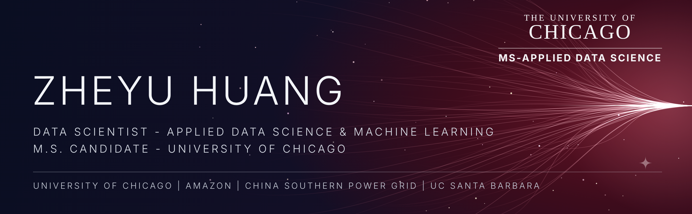

### Data Scientist — M.S. Applied Data Science, University of Chicago | B.S. Data Science, UC Santa Barbara | Ex-Amazon & China Southern Power Grid Data Intern

I turn large, messy operational data into decisions people can act on. I've done it on e-commerce data at 100-million-record scale for Amazon and on power-grid operations and security data for China Southern Power Grid.

**Now at the University of Chicago**, I'm in the MS in Applied Data Science (expected December 2027), a joint program with the Booth School of Business. There I'm building the engineering, MLOps and generative AI depth to take analysis from a notebook into production.

---

## Value delivered

**Report prep cut from 2 hours to 20 minutes** at Amazon (Shanghai). I built Python/R automation and standardized data-processing workflows over global sales, customer and supply-chain data at 100-million-record scale, which raised team efficiency by 60% and reduced manual errors.

**+12% core-category conversion.** I partnered with operations and supply-chain teams, used dashboards to find business pain points, and recommended assortment, pricing and inventory actions that contributed to the lift.

**Grid-operations analytics at China Southern Power Grid.** I cleaned, integrated and standardized power-operations, customer-use and grid-security datasets, then delivered electricity-load trend and anomaly-detection reports and KPI dashboards for grid operations.

**Data governance and security research.** I contributed to proposals for a data-governance digital employee and a technology roadmap covering metadata, data quality, security and compliance, lakehouse, and trusted data spaces.

**Approval turnaround cut from 48 hours to 12** at UC Santa Barbara. I digitized three workflows and automated operations tracking with Excel and Python, cutting manual ledger work by 60%.

**500+ participants, +45% engagement.** As group leader of the UCSB Chinese Data Science Club, I led a 15-member team through five applied analytics projects and ran eight talks, four workshops and two data competitions.

---

## How I work

| As an analyst | As a builder and learner |
| --- | --- |
| Start from the business question: conversion, inventory, grid load, turnaround time | Automate whatever I have to do twice, from Python/R scripts to standardized pipelines |
| Clean and standardize data before trusting it; governance and quality come first | Learning cloud-native data engineering on GCP, Snowflake, Databricks, Spark and Delta |
| Anomaly detection and trend analysis on operational data | Docker and GitHub Actions for reproducible, deployable work |
| Dashboards that operations teams actually use to make decisions | Studying MLOps, inference engineering and applied generative AI |
| Partner closely with operations and supply-chain teams | Leading teams: 15-member analytics club, data competitions, workshops |

---

## Domains

---

## Stack

**Cloud & Data Platform**

**AI & Analytics**

**Build & Automate**

---

## Selected work

**E-commerce sales, retention and inventory analytics — Amazon (Shanghai).** Trend, retention and inventory-optimization reporting on 100-million-record global datasets, with automation that cut report prep from two hours to 20 minutes.

**Electricity-load trends and anomaly detection — China Southern Power Grid.** Statistical analysis and basic modeling in Python on grid-operations data, with KPI dashboards for operations teams.

**Data-governance technology roadmap — China Southern Power Grid.** Research covering metadata, data quality, security and compliance, lakehouse architecture and trusted data spaces.

**Applied analytics projects — UCSB Chinese Data Science Club.** Five team projects with a 15-member team, plus two data competitions for 500+ participants.

---

## Education

**M.S., Applied Data Science — University of Chicago** (expected December 2027)

Statistical Models · Machine Learning · Advanced ML & AI · Applied Generative AI & Multimodal Modeling · Causal Models · Time Series Analysis & Forecasting · Cloud-Native Data Engineering · Scalable Data Systems & AI Pipelines · Machine Learning Operations & Inference Engineering

**B.S., Data Science — University of California, Santa Barbara** (June 2026)

---

## Track record

**University of Chicago (current)** · **China Southern Power Grid Data Platform & Security** · **Amazon (Shanghai)** · University of California, Santa Barbara

Leadership: Group Leader, UCSB Chinese Data Science Club · Captain, UCSB Chinese Basketball Club

Languages: English · Mandarin · Cantonese

Looking for **data science, data engineering and machine learning internships**. Let's talk.
